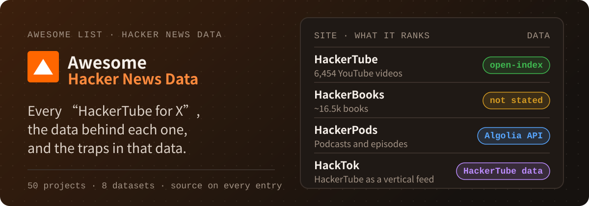

# Awesome Hacker News Data [](https://awesome.re)

**English** · [简体中文](README.zh-CN.md)

<p align="center">
  
</p>

<p align="center">
  <a href="https://github.com/AIshihzong/awesome-hacker-news-data/releases"></a>
  <a href="https://github.com/AIshihzong/awesome-hacker-news-data"></a>
  <a href="https://github.com/AIshihzong/awesome-hacker-news-data/actions/workflows/links.yml"></a>
  <a href="LICENSE"></a>
</p>

**Every "HackerTube for X", the dataset each one actually uses, and the traps in that data.**

> Unofficial. Not affiliated with HackerTube, Andrej Karpathy, open-index or Y Combinator.

**[Find a site by what it ranks](#the-hackertube-for-x-sites)** · **[Which data does it use?](docs/by-source.md)** · **[Is Show HN still worth it?](#is-show-hn-still-worth-it-the-evidence)** · **[Data quality traps](DATA_QUALITY.md)** · **[New this week](docs/new-this-week.md)** · **[Submit a project](https://github.com/AIshihzong/awesome-hacker-news-data/issues/new?template=project.yml)**

> ⭐ **Star this repo** to keep the list in your GitHub feed, or **Watch → Custom → Releases** to get one [weekly digest](https://github.com/AIshihzong/awesome-hacker-news-data/releases) of new HN data projects.

At the end of October 2026 Andrej Karpathy launched [HackerTube](https://hackertube.org), built by
filtering 43 million HN comments down to 6,454 videos people keep recommending. Within two days
there was a HackerTube for books, papers, blogs, podcasts, Wikipedia articles, tools and repos.
Most of them start from the same Parquet archive on Hugging Face, some call a live API, and many
never say. This list collects them, along with the older tools, the analyses and the traps you hit
when you query the data yourself.

**Data source labels**

| Label | Meaning |
|---|---|
| `open-index` | The project's README, site or author says it uses [open-index/hacker-news](https://huggingface.co/datasets/open-index/hacker-news) |
| `HackerTube data` | Built on [HackerTube's published export](https://hackertube.org/data) or its public JSON API, not the raw archive |
| `HackerBooks data` | Built on HackerBooks' downloadable data |
| `OpenPipe` | Uses the older [OpenPipe/hacker-news](https://huggingface.co/datasets/OpenPipe/hacker-news) dump, which ends in November 2023 |
| `Algolia API` · `HN API` · `BigQuery` | Queries a live source instead of the archive |
| `own data` | Collects and ships its own data |
| `not stated` | We could not find a source. Corrections welcome |

How each label is checked: [How this list stays accurate](#how-this-list-stays-accurate).

> Labels and figures were checked on 2026-11-03, and HN points are a snapshot from that day. Numbers computed from the archive cover data through 2026-08-21.

## The "HackerTube for X" sites

Mine comments for links of one kind, then rank by how many different people posted them.
[`queries/02_link_mining.sql`](queries/02_link_mining.sql) implements that pattern.

| Site | Ranks | Data source | Notes |
|---|---|---|---|
| [HackerTube](https://hackertube.org) | YouTube videos | `open-index` | The original. Its 43M-comment count matches the archive's 43.05M |
| [HackerBooks](https://hackerbooks.org) | Books (~16.5k, 2+ commenters) | `not stated` | Data downloadable from its about page. [Show HN](https://news.ycombinator.com/item?id=50326821), 1,829 points |
| [Wikihack](https://wikihack.netlify.app) | Wikipedia articles | `not stated` | [Show HN](https://news.ycombinator.com/item?id=50333339), 338 points |
| [Hacker Papers](https://academy.dair.ai/papers/collections/hacker-papers) | arXiv papers (1k+) | `not stated` | By DAIR.AI. The page carries an ODC-By credit |
| [HackerBlogs (.app)](https://hackerblogs.app) | Blogs (9,434 from 10.7M links) | `not stated` | Follow blogs and export them to RSS |
| [HackerBlogs (.org)](https://www.hackerblogs.org) · [repo](https://github.com/thejulez/hackerblogs) | Blogs, with feeds | `open-index` | A separate project from the .app site |
| [HN AI Tools](https://hnaitools.dev) · [repo](https://github.com/DontFretBrett/hn-ai-tools) | AI tools | `open-index` + `Algolia API` | |
| [Hacker Storytelling](https://hackerstorytelling.org) | 382 storytelling topics | `open-index` | Per the [author's post](https://x.com/kjv_life/status/2117195122555142325) |
| [HackerShelf](https://github.com/IshankDev/hackershelf) | Books from 2024–26 comments | `open-index` | |
| [HackerShelf (Tri Vo)](https://x.com/coyotevn/status/2117306682074436012) | 407 books (5+ threads across 4+ years) | `Algolia API` | Same name as the entry above, different project |
| [HackerPods](https://hackerpods.tiktalk.ing) | Podcasts and episodes | `Algolia API` | Has a methodology page |
| [ShowReel](https://showreel-hn.netlify.app) | Show HN product demos | `Algolia API` | |
| [Hackertools](https://shouvik12.github.io/hackertools) | Developer tools | `Algolia API` | |
| [hnrepos.com](https://hnrepos.com) | GitHub repositories | `BigQuery` | |
| [HackerX](https://hackerx.nishachay.tech) | X posts (266 of 2,733 scored) | `not stated` | |
| [HackerTubes](https://hackertubes.com) | YouTube videos | `open-index` | |
| [HackTok](https://hacktok.org) · [repo](https://github.com/rorz/hacktok) | HackerTube videos as a vertical feed | `HackerTube data` | |
| [OpenTube](https://github.com/vishalmysore/OpenTube) | 185k videos, filtered and measured | `open-index` | Reports accuracy and cost per pipeline stage, and builds a knowledge graph. [Write-up](https://medium.com/@visrow/karpathy-built-hackertube-i-built-opentube-20-years-of-hn-videos-filtered-af763bd270f4) |
| [Most-recommended GitHub repos](https://x.com/digital_iot/status/2117182997229346974) | Repos, by distinct recommenders | `open-index` | An analysis thread with methodology, not a site |
| [hackerrepos](https://jatingargiitk.github.io/hackerrepos/) · [repo](https://github.com/jatingargiitk/hackerrepos) | GitHub repos (29,109 linked by 3+ people) | `Algolia API` | Every github.com link in HN comments and stories since 2007 |
| [DesignerTube](https://www.designertube.app) · [repo](https://github.com/panikadak/designertube) | YouTube videos for designers (1,153) | `Algolia API` | Pipeline and filtering steps are documented |
| [PsychTube](https://github.com/contofalskyR/PsychTube) | Psychology videos and courses | `HackerTube data` | Adds psychology subreddits and Stack Exchange, with notes on findings that didn't replicate |
| [HackerBooks (pmaxx2023)](https://hacker-books-ecru.vercel.app) · [repo](https://github.com/pmaxx2023/HackerBooks) | Books (1,800 from 85,696 comments) | `Algolia API` | A separate project from hackerbooks.org |
| [HackerHype](https://epestr.com/hackerhype/) | The Hacker* sites themselves | `not stated` | An index of this whole genre |

### More HackerTube rebuilds

- [itsgg/hackytube](https://github.com/itsgg/hackytube): a straight rebuild. `open-index`
- [Syedomershah99/MyTube](https://github.com/Syedomershah99/MyTube): a straight rebuild. `open-index`
- [domijin/HackerTube](https://github.com/domijin/HackerTube): a straight rebuild. `open-index`
- [denrase/hackertube](https://github.com/denrase/hackertube): a straight rebuild. `open-index`
- [markokovac16/hackertube](https://github.com/markokovac16/hackertube): a stricter rule, 8+ distinct accounts across 3+ years, plus a "Rising" tier for newer videos. `Algolia API`
- [ayush-agrawal001/hackertube](https://github.com/ayush-agrawal001/hackertube): ranked by distinct sharers, with a static Astro site and VPS deploy scripts. `BigQuery`
- [nkodela/hackertube-rebuild](https://github.com/nkodela/hackertube-rebuild): one year of comments, plus LobsterTube built the same way from Lobsters. `Algolia API`
- [HacKiroTube](https://github.com/sanjayvs-shellkode/HacKiroTube): finds recommended videos that were deleted and searches for re-uploads. `Algolia API`
- [HN Screening Room](https://github.com/Benedict30/hn-screening-room): 6,427 videos with a For you feed and playlists, all stored in the browser. `HackerTube data`
- [yuanjohn01-byte/hacker-tube](https://github.com/yuanjohn01-byte/hacker-tube): an independent recreation with topics, playlists and search. `HackerTube data`

Want to build the next one? [`02_link_mining.sql`](queries/02_link_mining.sql) takes a URL
pattern and returns the links ranked by how many different people posted them. Vote for what
should exist next in the [issues](https://github.com/AIshihzong/awesome-hacker-news-data/issues).

## Most upvoted on HN

| Post | Points | Comments |
|---|---:|---:|
| [HackerTube: YouTube built from videos recommended by HN](https://news.ycombinator.com/item?id=50319510) | 2,841 | 632 |
| [Show HN: HackerBooks – HackerTube, but for books mentioned on HN](https://news.ycombinator.com/item?id=50326821) | 1,829 | 303 |
| [Show HN: Wikihack – HackerTube, but for Wikipedia articles mentioned on HN](https://news.ycombinator.com/item?id=50333339) | 338 | 103 |
| [Ask HN: Isn't anyone worried about this flood of HackerTube-but-for apps?](https://news.ycombinator.com/item?id=50336496) | 9 | 10 |

Points on 2026-11-03. Each copy drew less attention than the one before, and by the third day
most new ones stayed in single digits.

## Is Show HN still worth it? The evidence

If you are about to post your own HackerTube for X, this is what the archive says about Show HN.
From [`03_show_hn_trend.sql`](queries/03_show_hn_trend.sql), with the yearly series in
[`data/show_hn_yearly.csv`](data/show_hn_yearly.csv) and [`data/yearly.csv`](data/yearly.csv).

| | 2022 | 2024 | 2025 | 2026 (Jan–Aug) |
|---|---:|---:|---:|---:|
| Show HN posts | 10,119 | 17,643 | 28,389 | 32,616 |
| Share of all stories | 3.4% | 5.9% | 9.4% | 13.5% |
| Reach 100 points | 6.1% | 4.8% | **2.5%** | scores frozen |
| Get no comments | 47.9% | 53.7% | **62.3%** | counts frozen |
| Mention AI in the title | 5.0% | 21.6% | 29.1% | 36.0% |

Scores and comment counts for 2023 and 2026 are frozen in the archive, so their rates are left
out. See [the data quality notes](DATA_QUALITY.md#1-scores-and-comment-counts-are-frozen-in-25-months).

What still works, across all stories:

- **Launch HN** posts have reached 100 points 44% of the time since 2015, ordinary links 4.9%.
- Since 2018, titles with a year in brackets, such as "(2009)", reach 100 points 9.4% of the time, against 5.1% for all links.
- The best slot from 2020 on is **Sunday 11:00 UTC**, at 7.6% ([`06_posting_time.sql`](queries/06_posting_time.sql)).

## Contents

- [Quick start](#quick-start)
- [Read this first: data quality](#read-this-first-data-quality)
- [Datasets and APIs](#datasets-and-apis)
- [Apps, ports and translations](#apps-ports-and-translations)
- [Search, trends and exploration](#search-trends-and-exploration)
- [Infrastructure and tools](#infrastructure-and-tools)
- [Analysis and research](#analysis-and-research)
- [Query library](#query-library)
- [Twenty years in numbers](#twenty-years-in-numbers)
- [Derived data](#derived-data)

## Quick start

No download needed. In the [DuckDB](https://duckdb.org) CLI or Python:

```sql
INSTALL httpfs; LOAD httpfs; SET TimeZone = 'UTC';
SELECT year(time) AS yr, count(*) AS comments
FROM 'hf://datasets/open-index/hacker-news/data/2025/*.parquet'
WHERE type = 2
GROUP BY yr;
```

For real work, run [`queries/00_setup.sql`](queries/00_setup.sql) first. It defines `stories`,
`comments`, a `scored_stories` view that drops the broken months, and a `plain()` macro that
decodes HTML. To query offline, [`scripts/build_local_db.py`](scripts/build_local_db.py) builds a
1.1 GB local copy without comment text.

## Read this first: data quality

[DATA_QUALITY.md](DATA_QUALITY.md) has the details. The three that change results:

1. **Scores are frozen in 25 months**: 2012-04, 2012-11, 2012-12, 2013-02, 2022-12 through 2023-12, and all of
   2026 so far. Under 0.1% of stories in those months reach 100 points, against
   3–6% in normal months. Leave them out of any score-based metric.
2. **The archive stopped updating.** The last item is from 2026-08-21, and the dataset was last
   published on 2026-08-23.
3. **`time` is `TIMESTAMPTZ`.** Set `TimeZone = 'UTC'`, or years and hours shift to your local zone.

## Datasets and APIs

- [open-index/hacker-news](https://huggingface.co/datasets/open-index/hacker-news): every item from 2006-10 to 2026-08 as monthly Parquet files, about 12 GB, ODC-By. This is what most projects below use.
- [open-index/hacker-news-rss](https://huggingface.co/datasets/open-index/hacker-news-rss) and [open-index/hacker-news-text-search](https://huggingface.co/datasets/open-index/hacker-news-text-search): sibling datasets from the same publisher.
- [HackerTube data export](https://hackertube.org/data): the 6,454 videos, the comments that recommend them, related-video links and embeddings.
- [BigQuery `hacker_news` public dataset](https://console.cloud.google.com/marketplace/product/y-combinator/hacker-news): a SQL-queryable copy, reported in HN threads to be kept up to date.
- [ClickHouse example dataset](https://clickhouse.com/docs/getting-started/example-datasets/hacker-news): instructions for loading HN into ClickHouse.
- [Official HN API](https://github.com/HackerNews/API): Firebase, live, no key or rate limit.
- [Algolia HN Search API](https://hn.algolia.com/api): full-text search with date filters. Many small projects use it instead of the archive.
- [OpenPipe/hacker-news](https://huggingface.co/datasets/OpenPipe/hacker-news): all posts and comments up to 2023-11-01, 41.8M rows, about 11 GB.
- [sytelus/HackerNewsData](https://github.com/sytelus/HackerNewsData): an older dump of all stories and comments up to May 2014.

## Apps, ports and translations

- [hackertube.tv](https://github.com/ephraimduncan/hackertube.tv): HackerTube for Android TV. `not stated`
- [Jnaina/hackertube-tvos](https://github.com/Jnaina/hackertube-tvos): HackerTube on Apple TV. `open-index`
- [Rushikeshh-patil/hackertube-tv](https://github.com/Rushikeshh-patil/hackertube-tv): an Apple TV browser with offline semantic search. `HackerTube data`
- [cq0206/HackerTube](https://github.com/cq0206/HackerTube): a desktop app and Chrome extension. `HackerTube data`
- [bockybocky/hackertube-zh](https://github.com/bockybocky/hackertube-zh): a Traditional Chinese static site. `HackerTube data`
- [turygo/hackerbooks-zh](https://github.com/turygo/hackerbooks-zh): a Chinese mirror of HackerBooks with verified Chinese titles and Douban links. `HackerBooks data`
- [nickylin/HackerTubeApps](https://github.com/nickylin/HackerTubeApps): a native Android app for phones, tablets and TVs. `HackerTube data`
- [arguswaikhom/hackertube](https://github.com/arguswaikhom/hackertube): Android and iOS, with search that works offline. `HackerTube data`
- [4apaev/hackertube](https://github.com/4apaev/hackertube): another Apple TV app, reading HackerTube's JSON API. `HackerTube data`
- [iTzFaisal/hackertube](https://github.com/iTzFaisal/hackertube): HackerTube for Samsung (Tizen) TVs, ported from hackertube.tv. `HackerTube data`
- [layatai/hackertube-webos](https://github.com/layatai/hackertube-webos): HackerTube for LG webOS TVs, with remote shortcuts. `HackerTube data`
- [shreyasudupi/HackerTube-TV](https://github.com/shreyasudupi/HackerTube-TV): Fire TV and Android TV, as a fork of SmartTube. `HackerTube data`
- [stym06/hackertube-chrome](https://github.com/stym06/hackertube-chrome): a Chrome extension that adds an HN topic to the YouTube home feed. `HackerTube data`
- [whynimoisalive/hackertube-home](https://github.com/whynimoisalive/hackertube-home): a Chrome extension that replaces YouTube Home with HackerTube. `HackerTube data`
- [tunapro1234/hackertune](https://github.com/tunapro1234/hackertune): a self-hosted YouTube front end with Claude Code agents vetting your subscriptions. `HackerTube data`
- [Offbranch](https://thesybuilder.github.io/offbranch/) · [TheSyBuilder/offbranch](https://github.com/TheSyBuilder/offbranch): explore the videos on a map of 16 fields and 150 topics, in English and Chinese. `HackerTube data`
- [StudyHackerTube](https://github.com/Faouzi-Blibech/study-hackertube): upload a course PDF and get the HackerTube video segments that explain each chapter. `HackerTube data`
- [wangw0922/hackertube](https://github.com/wangw0922/hackertube): a self-hosted HackerTube with an English and Chinese interface. `HackerTube data`
- [joeseesun/hackerbooks-cn](https://github.com/joeseesun/hackerbooks-cn): a Chinese edition of HackerBooks with 15,362 books and translated titles. `HackerBooks data`
- [WenwenXdaddy/hackerbooks](https://github.com/WenwenXdaddy/hackerbooks): a Chinese HackerBooks shelf with Open Library covers and recent mentions. `HackerBooks data` + `Algolia API`
- [PASSIONYOUNGZ/HackerBooks](https://github.com/PASSIONYOUNGZ/HackerBooks): 15,766 HackerBooks titles sorted into 32 topics, in Chinese. `HackerBooks data`

## Search, trends and exploration

- [Hacker News Trends](https://hackernewstrends.com) · [upstash/hacker-trends](https://github.com/upstash/hacker-trends): search 45M posts and comments and chart any term over time. `open-index`
- [HN N-gram Viewer](https://hngram.com) · [jchook/hngram](https://github.com/jchook/hngram): word frequency over time, stored in ClickHouse. `open-index`
- [dacapoday/hn](https://github.com/dacapoday/hn): browse and query HN from the terminal with DuckDB. `open-index`
- [hn.persona](https://hn-persona.vercel.app) · [xydac/hn-persona](https://github.com/xydac/hn-persona): profile any user's posting patterns, interests and writing style. `open-index`
- [ziahamza/parle-extension](https://github.com/ziahamza/parle-extension): a browser extension that shows what HN, Reddit and X said about the page you are on. `open-index`
- [amterp/amber](https://github.com/amterp/amber): resurface the best HN content from any past period. `Algolia API`
- [Querying Hacker News with DuckDB](https://ssp.sh/brain/querying-hackernews-with-duckdb-directly/): HackerTube, HackerBooks and Wikihack rebuilt as three queries, with an in-browser runner. `open-index`
- [Searching all of HN on a laptop](https://discuss.ai.google.dev/t/searching-all-of-hacker-news-with-embeddinggemma-2-on-a-laptop-49-3m-items-5-3-gb/196641): 49.3M items in one 5.34 GB EmbeddingGemma index. `not stated`

## Infrastructure and tools

- [tamnd/hn-fdw](https://github.com/tamnd/hn-fdw): query the full archive from Postgres through `duckdb_fdw`, without copying any data. By the dataset's author. `open-index`
- [nyacg/pagedb](https://github.com/nyacg/pagedb): a 100 GB live-synced database in one Cloudflare Durable Object, with an HN demo that has title and semantic search. `open-index`
- [huggingface/hf-mount](https://github.com/huggingface/hf-mount): mount Hugging Face repos as local filesystems. Its README uses this dataset as the example. `open-index`
- [davanstrien/uv-scripts › build-atlas](https://github.com/davanstrien/uv-scripts/tree/main/build-atlas): prepares HN for an embedding atlas. `open-index`
- [credibledata/hackernews-demo](https://github.com/credibledata/hackernews-demo): ask natural-language questions through a Malloy semantic model. `open-index`
- [stevemurr/windex](https://github.com/stevemurr/windex): a self-hosted web index for search agents, with HN as one source. `open-index`
- [iannuttall/hn-get](https://github.com/iannuttall/hn-get): one HN pipeline for CLI, MCP, HTTP and RSS. `Algolia API` + `HN API`

## Analysis and research

- [zaporter/hacker-news-quality](https://github.com/zaporter/hacker-news-quality): an LLM scores comments from 2015–2026 to test whether HN quality has really declined. `open-index`
- [malakhov-dmitrii/hackernews-simulator](https://github.com/malakhov-dmitrii/hackernews-simulator): predicts a post's score and simulates its comments before you submit. `open-index`
- [kevinw-openai/hackernews-openclaw-analysis](https://github.com/kevinw-openai/hackernews-openclaw-analysis): a single-topic trend report with a browsing UI. `open-index`
- [google-research › dp_clip](https://github.com/google-research/google-research/tree/master/dp_clip): differential-privacy research that loads HN as a sparse user-by-thread matrix. `open-index`
- [saqibns/cheap-hackertube](https://github.com/saqibns/cheap-hackertube): tests whether a plain frequency count reproduces HackerTube's LLM-filtered list. `OpenPipe`
- [Reverse-engineering the HN ranking algorithm](https://github.com/sangaline/reverse-engineering-the-hacker-news-ranking-algorithm): a 2017 analysis of historical front-page data, which ships with the repo. `own data`

## Query library

Every query runs against the Hugging Face files directly. Run [`00_setup.sql`](queries/00_setup.sql)
first. Full-archive scans take minutes, and `00_setup.sql` shows how to start with one year.

| Query | Answers |
|---|---|
| [01_frozen_score_months](queries/01_frozen_score_months.sql) | Which months have unusable scores? |
| [02_link_mining](queries/02_link_mining.sql) | The HackerTube pattern for any kind of link |
| [03_show_hn_trend](queries/03_show_hn_trend.sql) | Show HN volume and the odds of reaching 100 points, by year |
| [04_domain_win_rate](queries/04_domain_win_rate.sql) | Which sites reliably reach the front page |
| [05_demand_phrases](queries/05_demand_phrases.sql) | "I'd pay for…", "I wish there was…", "is there a tool…" |
| [06_posting_time](queries/06_posting_time.sql) | Best weekday and UTC hour to post |
| [07_commenter_retention](queries/07_commenter_retention.sql) | How many new commenters come back the next year |

## Twenty years in numbers

Computed from the full archive, with frozen months excluded wherever a number depends on scores.
The yearly series are in [`data/`](data/).

**The community**
- 1% of commenters write **55.4%** of all comments.
- 43.3% of people who first commented in 2008 commented again in 2009. For the 2024 cohort that
  share was **16.0%**.
- The average comment shrank from 401 characters in 2016 to **337** in 2026. The share of dead
  comments rose from 1.25% to **3.92%**.
- Comments per story peaked at 13.2 in 2022 and were 11.5 in 2025.

**What gets upvoted**
- Since 2015, Launch HN posts have reached 100 points **44%** of the time, ordinary links 4.9% and
  Ask HN 2.8%.
- Since 2018, titles with a year in brackets, such as "(2009)", reach 100 points **9.4%** of the time, against
  5.1% for all links. Titles under 15 characters do 6.6%, and 60+ characters about 4.6%.
- The best slot from 2020 on is **Sunday 11:00 UTC**, at 7.6%.
- By domain since 2018, blog.ycombinator.com leads at 23.2%, then jvns.ca at 22.1% and hacks.mozilla.org at
  21.1%. medium.com manages 1.4% across 51,131 submissions.

**The AI wave**
- AI terms appeared in 0.85% of story titles in 2016, 10.4% in 2024 and **21.0%** in 2026. In
  2025, AI stories reached 100 points 3.2% of the time, against 4.8% for everything else.
- Product Hunt links almost vanished from HN after 2019, from about 300 a year to single digits.

## Derived data

[`data/`](data/) holds small CSVs computed from the archive: yearly metrics, monthly story counts
with a `scores_usable` flag, commenter cohorts, domain win rates, Show HN by year, and sampled
demand-phrase counts. They inherit the source's
[ODC-By](https://opendatacommons.org/licenses/by/1-0/) attribution requirement. Credit
open-index/hacker-news and Hacker News.

## Contributing

Use the [project form](https://github.com/AIshihzong/awesome-hacker-news-data/issues/new?template=project.yml)
or open a pull request. See [CONTRIBUTING.md](CONTRIBUTING.md), and [AGENTS.md](AGENTS.md) if a
coding agent is writing the change. Each entry needs a working link, one line on what it does, and
a data source label backed by something you can point to. Fixing a wrong label is as welcome as
adding a project.

### How this list stays accurate

- Every label has a source: the project's README, its site or the author's post. When we can't find one, the entry says `not stated` rather than guessing.
- [`scripts/validate_list.py`](scripts/validate_list.py) runs on every pull request. It checks labels, the table of contents, relative links, the project count and that [docs/by-source.md](docs/by-source.md) is current.
- A link check runs on every pull request and every Monday ([`links.yml`](.github/workflows/links.yml)).
- A daily search collects new candidate repos into one issue. Nothing is added automatically: a maintainer reads each source and labels it by hand.
- Numbers carry the date they were checked, and every change ships in the [weekly digest](https://github.com/AIshihzong/awesome-hacker-news-data/releases).

## License

The list, queries and scripts are [CC0](LICENSE). The derived data follows the source dataset's
ODC-By license. Hacker News content belongs to its authors.

---

If this list saved you a search, a ⭐ helps the next person find it. New projects arrive every week in the [weekly digest](https://github.com/AIshihzong/awesome-hacker-news-data/releases).
