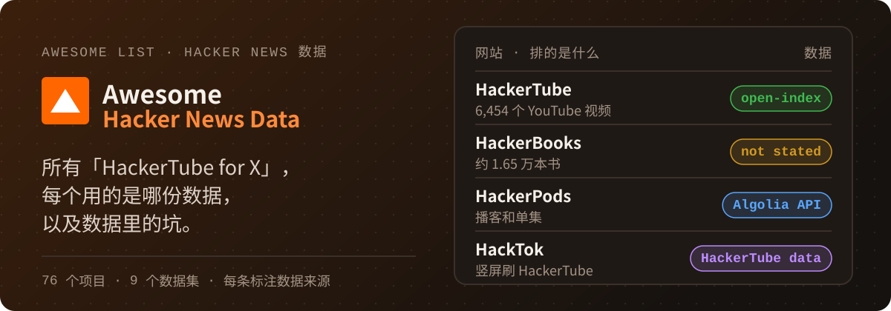

# Awesome Hacker News Data（中文） [](https://awesome.re)

[English](README.md) · **简体中文**

<p align="center">
  
</p>

<p align="center">
  <a href="https://github.com/AIshihzong/awesome-hacker-news-data/releases"></a>
  <a href="https://github.com/AIshihzong/awesome-hacker-news-data"></a>
  <a href="https://github.com/AIshihzong/awesome-hacker-news-data/actions/workflows/links.yml"></a>
  <a href="LICENSE"></a>
</p>

**所有「HackerTube for X」，每个实际用的是哪份数据，以及这份数据里的坑。**

> 非官方合集，与 HackerTube、Andrej Karpathy、open-index 和 Y Combinator 均无关联。

**[按排行内容找网站](#hackertube-for-x类网站)** · **[它用的是哪份数据？](docs/by-source.zh-CN.md)** · **[Show HN 还值得发吗？](#show-hn-还值得发吗数据怎么说)** · **[数据质量的坑](DATA_QUALITY.md)** · **[本周新增](docs/new-this-week.zh-CN.md)** · **[提交项目](https://github.com/AIshihzong/awesome-hacker-news-data/issues/new?template=project.yml)**

> ⭐ **点个 Star**，合集更新会出现在你的 GitHub 动态里；或者 **Watch → Custom → Releases**，每周收到一期 [周报](https://github.com/AIshihzong/awesome-hacker-news-data/releases)。

2026 年 10 月底，Karpathy 从 4300 万条 HN 评论里筛出 6,454 个被反复推荐的视频，做成了
[HackerTube](https://hackertube.org)。两天之内，书、论文、博客、播客、Wikipedia 条目、工具、
仓库的「HackerTube 版」全都冒了出来。大多数用的是 Hugging Face 上同一份 Parquet 存档，
有的调用实时 API，还有很多根本没说。**每个条目都标注了数据实际从哪来**，方便你分辨哪些项目
共用同一条数据管线、哪些可以自己复现。

## 数据来源标签

| 标签 | 含义 |
|---|---|
| `open-index` | 项目的 README、网站或作者说明使用了 [open-index/hacker-news](https://huggingface.co/datasets/open-index/hacker-news) |
| `HackerTube data` | 基于 [HackerTube 公开的导出数据](https://hackertube.org/data)或它的公开 JSON API，不是原始存档 |
| `HackerBooks data` | 基于 HackerBooks 提供下载的数据 |
| `OpenPipe` | 使用较早的 [OpenPipe/hacker-news](https://huggingface.co/datasets/OpenPipe/hacker-news) 数据，截至 2023 年 11 月 |
| `Algolia API` · `HN API` · `BigQuery` | 查询的是实时数据源，不是这份存档 |
| `own data` | 自己采集并附带数据 |
| `not stated` | 没找到数据来源，欢迎补充 |

> 标签和数字核对于 2026-11-03，HN 分数是当天的快照。基于存档计算的数字覆盖到 2026-08-21。

## 「HackerTube for X」类网站

套路都一样：从评论里提取某类链接，按「有多少不同的人贴过」排序。
[`queries/02_link_mining.sql`](queries/02_link_mining.sql) 实现了这个通用写法。

| 网站 | 排的是什么 | 数据来源 |
|---|---|---|
| [HackerTube](https://hackertube.org) | YouTube 视频 | `open-index` |
| [HackerBooks](https://hackerbooks.org) | 书（约 1.65 万本） | `not stated` |
| [Wikihack](https://wikihack.netlify.app) | Wikipedia 条目 | `not stated` |
| [Hacker Papers](https://academy.dair.ai/papers/collections/hacker-papers) | arXiv 论文 | `not stated` |
| [HackerBlogs (.app)](https://hackerblogs.app) | 博客 | `not stated` |
| [HackerBlogs (.org)](https://www.hackerblogs.org) | 博客和订阅源 | `open-index` |
| [HN AI Tools](https://hnaitools.dev) | AI 工具 | `open-index` + `Algolia API` |
| [Hacker Storytelling](https://hackerstorytelling.org) | 讲故事、写故事的话题 | `open-index` |
| [HackerPods](https://hackerpods.tiktalk.ing) | 播客 | `Algolia API` |
| [ShowReel](https://showreel-hn.netlify.app) | Show HN 产品演示 | `Algolia API` |
| [Hackertools](https://shouvik12.github.io/hackertools) | 开发者工具 | `Algolia API` |
| [hnrepos.com](https://hnrepos.com) | GitHub 仓库 | `BigQuery` |
| [HackTok](https://hacktok.org) | 竖屏刷 HackerTube 视频 | `HackerTube data` |
| [hackerrepos](https://jatingargiitk.github.io/hackerrepos/) | GitHub 仓库（29,109 个，至少 3 人推荐） | `Algolia API` |
| [DesignerTube](https://www.designertube.app) | 推荐给设计师的 YouTube 视频（1,153 个） | `Algolia API` |
| [PsychTube](https://github.com/contofalskyR/PsychTube) | 心理学视频和课程 | `HackerTube data` |
| [HackerHype](https://epestr.com/hackerhype/) | 这类网站本身的索引 | `not stated` |

完整列表，包括客户端、移植版、搜索工具、基础设施和研究项目，见[英文 README](README.md)，
或按数据来源分组的[索引页](docs/by-source.zh-CN.md)。中文相关的有：

- [hackerbooks-zh](https://github.com/turygo/hackerbooks-zh)：HackerBooks 中文镜像，附豆瓣链接。
- [hackerbooks-cn](https://github.com/joeseesun/hackerbooks-cn)：HackerBooks 中文版，15,362 本书，书名和简介有中文翻译。
- [WenwenXdaddy/hackerbooks](https://github.com/WenwenXdaddy/hackerbooks)：中文书架，补充了 Open Library 封面和近一年的提及数。
- [PASSIONYOUNGZ/HackerBooks](https://github.com/PASSIONYOUNGZ/HackerBooks)：15,766 本书按 32 个主题整理成中文书单。
- [hackertube-zh](https://github.com/bockybocky/hackertube-zh)：繁体中文版 HackerTube。
- [Offbranch](https://thesybuilder.github.io/offbranch/)：用 16 个领域、150 个主题的地图浏览 HackerTube 视频，支持中英文。
- [wangw0922/hackertube](https://github.com/wangw0922/hackertube)：可自己部署的中英双语 HackerTube。

想做下一个？[`02_link_mining.sql`](queries/02_link_mining.sql) 输入一个链接模式，就能按贴过的人数排出结果。
想看到哪种「HackerTube for X」，可以去 [Issues](https://github.com/AIshihzong/awesome-hacker-news-data/issues) 投票。

## HN 上最受关注的帖子

| 帖子 | 分数 | 评论 |
|---|---:|---:|
| [HackerTube: YouTube built from videos recommended by HN](https://news.ycombinator.com/item?id=50319510) | 2,841 | 632 |
| [Show HN: HackerBooks – HackerTube, but for books mentioned on HN](https://news.ycombinator.com/item?id=50326821) | 1,829 | 303 |
| [Show HN: Wikihack – HackerTube, but for Wikipedia articles mentioned on HN](https://news.ycombinator.com/item?id=50333339) | 338 | 103 |
| [Ask HN: Isn't anyone worried about this flood of HackerTube-but-for apps?](https://news.ycombinator.com/item?id=50336496) | 9 | 10 |

分数截至 2026-11-03。每个跟风项目得到的关注都比前一个少，到第三天，大多数新项目只有个位数分数。

## Show HN 还值得发吗？数据怎么说

如果你也准备发一个自己的 HackerTube for X，先看看存档里 Show HN 的情况。数据来自
[`03_show_hn_trend.sql`](queries/03_show_hn_trend.sql)，逐年数据见
[`data/show_hn_yearly.csv`](data/show_hn_yearly.csv) 和 [`data/yearly.csv`](data/yearly.csv)。

| | 2022 | 2024 | 2025 | 2026（1–8 月） |
|---|---:|---:|---:|---:|
| Show HN 帖子数 | 10,119 | 17,643 | 28,389 | 32,616 |
| 占全部帖子 | 3.4% | 5.9% | 9.4% | 13.5% |
| 达到 100 分 | 6.1% | 4.8% | **2.5%** | 分数冻结 |
| 零评论 | 47.9% | 53.7% | **62.3%** | 评论数冻结 |
| 标题提到 AI | 5.0% | 21.6% | 29.1% | 36.0% |

2023 年和 2026 年的分数和评论数在存档里被冻结了，所以不计算这两年的比例。
详见[数据质量说明](DATA_QUALITY.md#1-scores-and-comment-counts-are-frozen-in-25-months)。

仍然有效的做法（全部帖子）：

- 2015 年以来，**Launch HN** 有 44% 达到 100 分，普通链接只有 4.9%。
- 2018 年以来，标题带年份（如「(2009)」）的帖子有 9.4% 达到 100 分，所有链接平均是 5.1%。
- 2020 年以来，最好的发帖时间是**周日 UTC 11 点**，达到 100 分的比例是 7.6%（[`06_posting_time.sql`](queries/06_posting_time.sql)）。

## 快速开始

不用下载，在 [DuckDB](https://duckdb.org) 里直接查：

```sql
INSTALL httpfs; LOAD httpfs; SET TimeZone = 'UTC';
SELECT year(time) AS yr, count(*) AS comments
FROM 'hf://datasets/open-index/hacker-news/data/2025/*.parquet'
WHERE type = 2
GROUP BY yr;
```

正式分析前先运行 [`queries/00_setup.sql`](queries/00_setup.sql)。它会建好 `stories`、`comments`
两个视图，一个已经剔除坏月份的 `scored_stories` 视图，以及解码 HTML 的 `plain()` 宏。
想离线查询，可以用 [`scripts/build_local_db.py`](scripts/build_local_db.py) 建一个不含评论正文、
约 1.1 GB 的本地库。

## 先读这个：数据质量

详见 [DATA_QUALITY.md](DATA_QUALITY.md)。会改变结论的有三条：

1. **25 个月的分数被冻结**：2012-04、2012-11、2012-12、2013-02、2022-12 至 2023-12，以及 2026
   年至今。这些月份里达到 100 分的帖子不到 0.1%，正常月份是 3–6%。凡是用到分数的指标都要剔除它们。
2. **存档已停止更新**：最后一条数据是 2026-08-21，数据集最后一次发布是 2026-08-23。
3. **`time` 是带时区的时间戳**：先设 `TimeZone = 'UTC'`，否则年份和小时会按你的本地时区计算。

## 二十年的数字

基于全量存档计算，凡是依赖分数的指标都已剔除冻结月份。

- 1% 的评论者写了 **55.4%** 的评论。
- 2008 年首次评论的人，有 43.3% 第二年还在评论。2024 年的新人只有 **16.0%**。
- 平均评论长度从 2016 年的 401 个字符降到 2026 年的 **337**。被处理（dead）的评论比例从 1.25% 升到 **3.92%**。
- 2015 年以来，Launch HN 有 **44%** 达到 100 分，普通链接 4.9%，Ask HN 2.8%。
- 2018 年以来，标题带年份（如「(2009)」）的帖子有 **9.4%** 达到 100 分，所有链接平均是 5.1%。
- 2020 年以来，最好的发帖时间是**周日 UTC 11 点**（7.6%）。
- 标题含 AI 词的帖子占比：2016 年 0.85%，2024 年 10.4%，2026 年 **21.0%**。
- 2019 年之后，HN 上几乎看不到 Product Hunt 链接，从每年约 300 条降到个位数。

## 参与贡献

可以用[项目表单](https://github.com/AIshihzong/awesome-hacker-news-data/issues/new?template=project.yml)提交，
也可以直接提 PR，规则见 [CONTRIBUTING.md](CONTRIBUTING.md)。每个条目需要：能打开的链接、一句话说明，
以及有据可查的数据来源标签。纠正错误的标签和添加新项目一样有价值。

### 这份合集怎么保证准确

- 每个标签都有出处：项目 README、网站或作者的帖子。找不到出处就标 `not stated`，不靠猜。
- 每个 PR 都会运行 [`scripts/validate_list.py`](scripts/validate_list.py)，检查标签、目录、相对链接、项目数，以及[按来源索引页](docs/by-source.zh-CN.md)是否最新。
- 每个 PR 和每周一都会跑一次链接检查（[`links.yml`](.github/workflows/links.yml)）。
- 每天自动搜索新的候选仓库，汇总到一个 issue 里。不会自动收录，维护者逐个核对出处后手动打标签。
- 数字都注明核对日期，每次更新都会写进[周报](https://github.com/AIshihzong/awesome-hacker-news-data/releases)。

## 许可

列表、查询和脚本采用 [CC0](LICENSE)。派生数据沿用源数据集的 ODC-By 许可。HN 内容的权利属于各自作者。

---

如果这份合集帮你省了搜索时间，点个 ⭐ 能帮下一个人找到它。每周的新项目都会写进[周报](https://github.com/AIshihzong/awesome-hacker-news-data/releases)。
